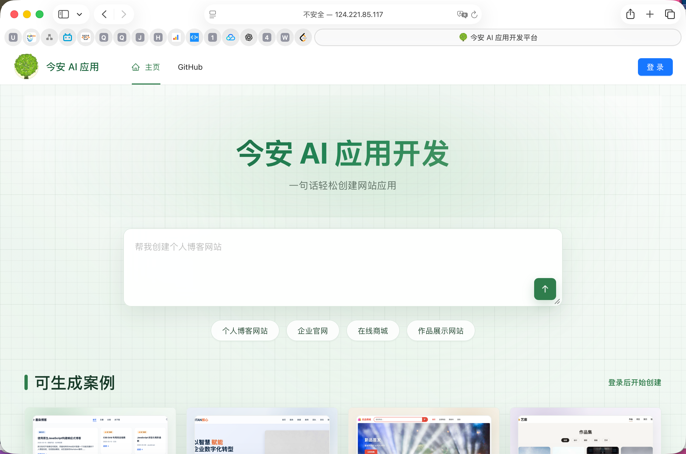
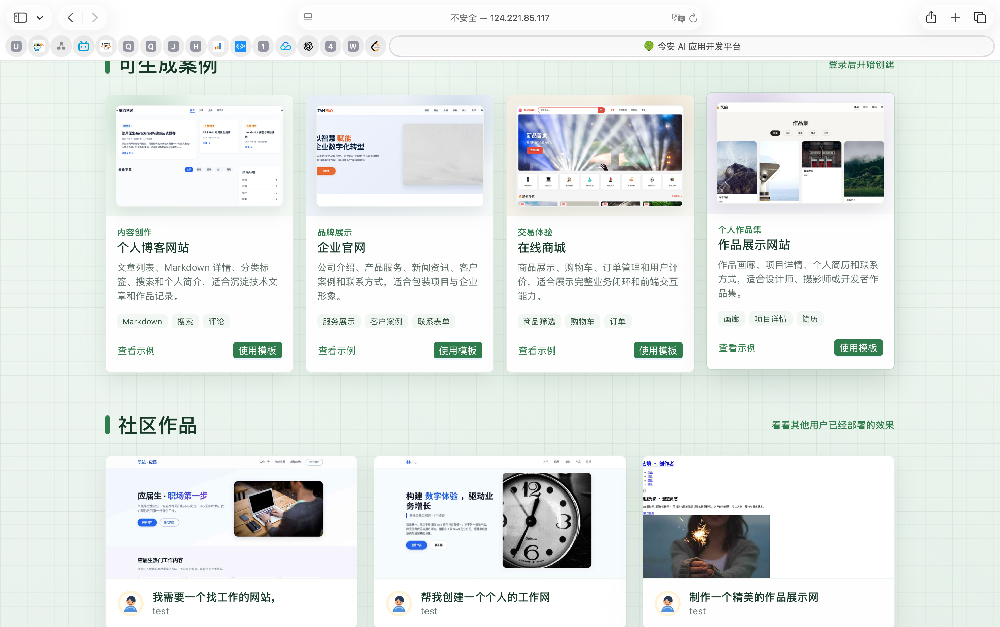
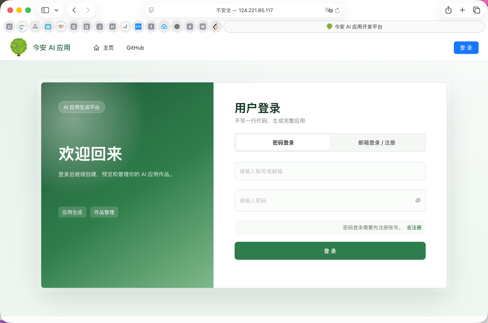
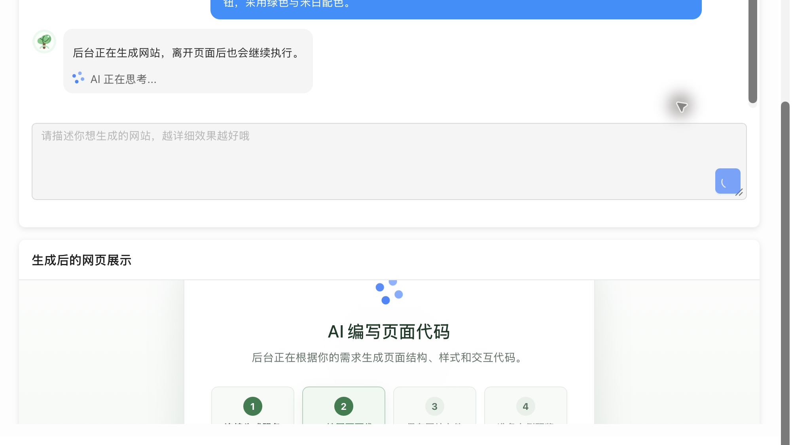
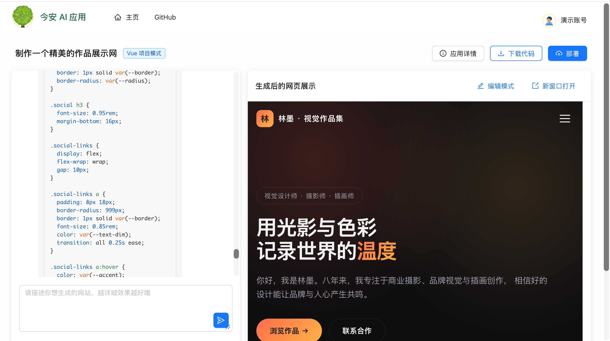
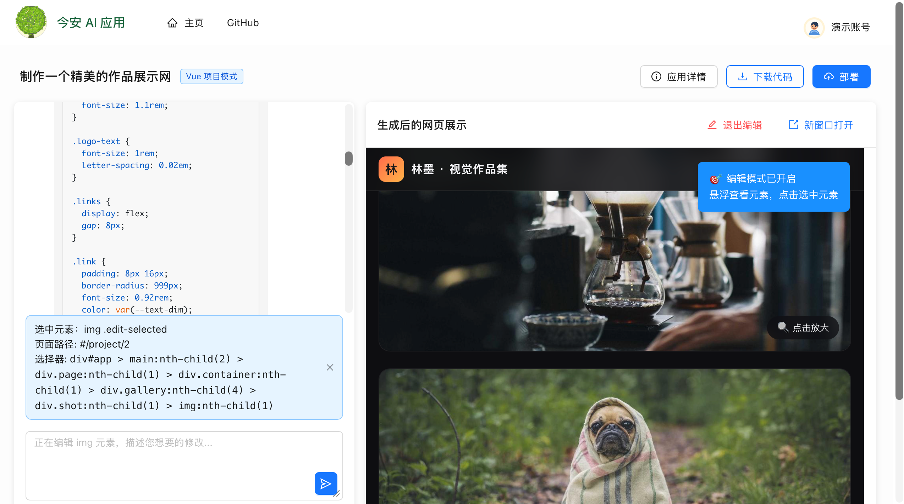
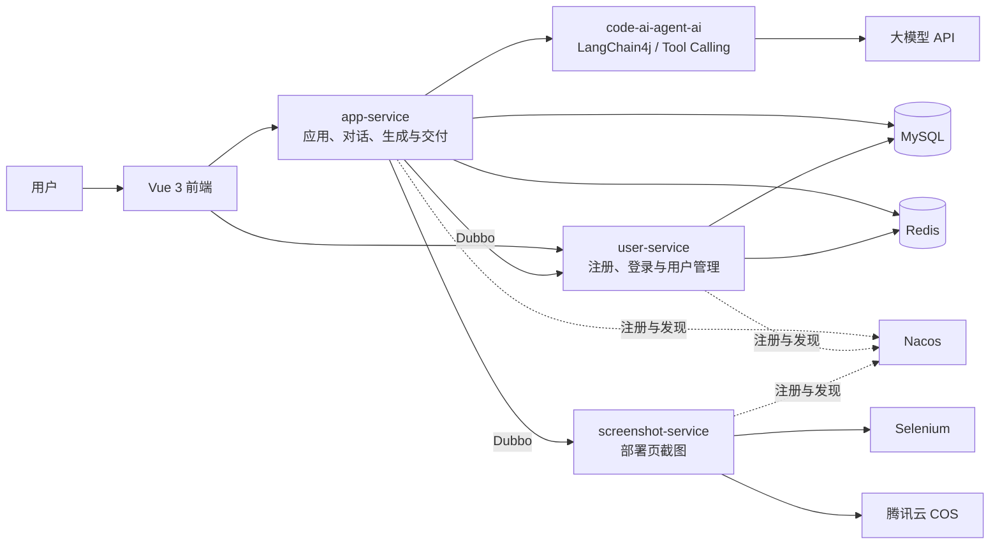

<div align="center">
  
  <h1>今安 AI 应用开发平台</h1>
  <p><strong>用自然语言生成、持续编辑并发布可运行的网站</strong></p>
  <p>
    <a href="https://ai.lijinan.cn">在线体验</a> ·
    <a href="https://ai.lijinan.cn/api/doc.html#/home">接口文档</a> ·
    <a href="#功能展示">功能展示</a> ·
    <a href="#本地启动">本地运行</a>
  </p>
  <p>
    <a href="https://github.com/Li-Jinan/code-ai-agent/actions/workflows/ci.yml"></a>
    
    
    
    
    
  </p>
</div>

## 项目概览

| 项目 | 内容 |
| --- | --- |
| 项目名称 | 今安 AI 应用开发平台（`code-ai-agent`） |
| 项目定位 | 面向真实应用交付的微服务化 AI 网站生成平台，而不是通用聊天机器人 |
| 生成模式 | 单页 HTML、多文件网站、Vue 项目 |
| 完整链路 | 需求输入 → AI 生成 → 持续编辑 → 在线预览 → 源码下载 / 站点部署 |

基于 Vue 3、Spring Boot、LangChain4j、Dubbo 与 Nacos 构建。用户可以用自然语言描述需求，生成可运行的网站项目，并通过 Tool Calling、应用级对话记忆和可视化选区继续迭代，最终完成预览、下载、部署与作品封面生成。

## 项目来源与二次开发说明

本项目基于开源项目 [liyupi/yu-ai-code-mother](https://github.com/liyupi/yu-ai-code-mother) 进行二次开发。上游项目提供了 AI 应用生成、Tool Calling、Redis 对话记忆与 LangGraph4j 工作流等基础能力；本仓库在此基础上聚焦生成链路可靠性、微服务化部署与账号体系工程化。

为使项目经历与代码状态可核对，二次开发内容及其公开状态如下：

| 二次开发内容 | 具体改造 | 代码状态 |
| --- | --- | --- |
| 生成任务异步化与可恢复 | 将长耗时生成改为后台任务，持久化 `pending / running / succeeded / failed` 状态；同一应用复用运行中任务，刷新后恢复进度，并在生成物可预览后才标记成功 | [实现提交](https://github.com/Li-Jinan/code-ai-agent/commit/9a37a62) · [结果校验](https://github.com/Li-Jinan/code-ai-agent/commit/2c1dbbe) |
| Vue 工程生成可靠性 | 将 Vue 生成改为请求级会话内存，隔离 Redis 中残留的工具调用上下文，并识别工具调用协议异常 | [实现提交](https://github.com/Li-Jinan/code-ai-agent/commit/aa77392) |
| 工具输出与上下文控制 | 目录读取跳过 `node_modules` 等大目录，限制条目数与输出长度，补充路径穿越校验和单元测试，避免工具输出撑爆上下文 | [实现提交](https://github.com/Li-Jinan/code-ai-agent/commit/ea5783b) |
| 异步监控上下文传递 | 将流式回调跨线程后的监控上下文由 `ThreadLocal` 改为随模型请求 `attributes` 传递，并增加空值兜底 | [实现提交](https://github.com/Li-Jinan/code-ai-agent/commit/ea5783b) |
| 任务心跳与时钟同源 | 心跳写入与过期判断统一使用 MySQL 时钟（`CURRENT_TIMESTAMP - INTERVAL n SECOND`），修复数据库与 JVM 时区不一致时新任务被误判超时并回收的问题；补充时区错位集成测试 | [集成测试](code-ai-agent-microservice/code-ai-agent-app/src/test/java/com/jinan/codeaiagent/service/impl/GenerationTaskMySqlIntegrationTest.java) |
| 微服务部署与登录 | 以 Docker Compose 编排 MySQL、Redis、Nacos、Selenium 和三个 Dubbo 服务，增加健康检查、Nginx 统一入口、邮箱验证码登录与 IP 限流 | 本次合入 `main` |

> 上述二次开发代码、测试、数据库迁移与部署文档均已合入 `main`。
>
> 生成任务的并发占位、心跳回收与时区错位行为由真实 MySQL 集成测试覆盖：在 MySQL 8.4 的 `UTC` 与 `+08:00` 两种时区下（JVM 为 Asia/Shanghai），`GenerationTaskMySqlIntegrationTest` 均为 4 通过、0 跳过。未传入 `mysql.it.url` 时该测试会自动跳过，复现方式：
>
> ```bash
> cd code-ai-agent-microservice
> mvn -pl code-ai-agent-app -am test -Dtest=GenerationTaskMySqlIntegrationTest -Dsurefire.failIfNoSpecifiedTests=false \
>   "-Dmysql.it.url=jdbc:mysql://localhost:3306/generation_task_it?allowPublicKeyRetrieval=true&useSSL=false" \
>   -Dmysql.it.username=root -Dmysql.it.password=<密码>
> ```
>
> 测试库名必须为 `generation_task_it`，测试会自建并清空 `generation_task` 表。

## 项目亮点

| 多模式生成 | 交互式迭代 | 完整交付闭环 |
| --- | --- | --- |
| 支持 HTML、多文件网站与 Vue 项目，按需求选择生成类型 | 通过可恢复的后台任务展示进度，结合 Tool Calling 和可视化选区持续修改 | 提供在线预览、源码下载、站点部署与自动封面生成 |

## 在线体验

| 类型 | 地址 |
| --- | --- |
| 在线应用 | [https://ai.lijinan.cn](https://ai.lijinan.cn) |
| 接口文档 | [https://ai.lijinan.cn/api/doc.html#/home](https://ai.lijinan.cn/api/doc.html#/home) |
| GitHub 源码 | [Li-Jinan/code-ai-agent](https://github.com/Li-Jinan/code-ai-agent) |

## 功能展示

> 以下均为线上环境真实页面截图。

### 首页与需求输入



### 首页案例与社区作品



### 账号密码登录



### 创建应用与 AI 生成过程



### 生成结果预览



### 可视化编辑模式



## 系统架构

当前主实现位于 `code-ai-agent-microservice`。其中 `app`、`user`、`screenshot` 是可独立运行的 Spring Boot 服务，`ai`、`client`、`model`、`common` 是供服务复用的 Maven 模块。



服务间通过 Dubbo 调用，并使用 Nacos 完成注册与发现；Redis 承担会话、对话记忆和限流等状态能力。

### 模块职责

| 模块 | 类型 | 主要职责 |
| --- | --- | --- |
| `code-ai-agent-app` | 独立服务 | 应用管理、对话历史、AI 生成编排、限流、预览、下载与部署 |
| `code-ai-agent-user` | 独立服务 | 用户注册、登录、会话与用户管理，并向应用服务提供用户 RPC |
| `code-ai-agent-screenshot` | 独立服务 | 通过 Selenium 生成部署页截图并上传腾讯云 COS |
| `code-ai-agent-ai` | 共享模块 | LangChain4j 模型接入、代码生成服务、对话记忆、护栏与文件工具 |
| `code-ai-agent-client` | 共享模块 | Dubbo 内部服务接口 |
| `code-ai-agent-model` | 共享模块 | 实体、DTO、VO 与枚举 |
| `code-ai-agent-common` | 共享模块 | 通用响应、异常、配置、常量与基础能力 |

## 核心能力

- **多类型代码生成**：根据需求生成单页 HTML、多文件网站或 Vue 项目，并自动选择合适的生成类型。
- **异步生成与可恢复**：使用后台任务持久化生成状态，前端轮询最新任务；刷新或重新进入页面后可恢复进度，仅在生成物可预览时标记成功。
- **Agent 文件工具**：封装文件读取、写入、修改、删除、目录读取和退出工具，使 Vue 项目可以在受控目录内持续迭代。
- **应用级上下文**：使用 Redis ChatMemory 隔离不同应用的上下文，并从 MySQL 对话历史恢复会话。
- **可视化修改**：在预览区选择页面元素，将标签、选择器、文本和页面路径作为上下文继续生成。
- **结果交付闭环**：支持 iframe 预览、源码压缩下载、站点部署和作品封面生成。
- **服务治理**：基于 Nacos 与 Dubbo 完成服务注册、发现和 RPC，使用 Redis Session 共享登录态。
- **稳定性设计**：使用 Redisson 进行用户级限流，使用 Caffeine 缓存应用级 AI 服务实例。

## 核心链路

### 1. 用户与会话

用户服务负责注册、登录和用户管理，登录会话保存在 Redis；应用服务通过 Dubbo 获取用户信息。

### 2. 创建应用与选择生成类型

前端调用 `POST /api/app/add` 创建应用。应用服务根据初始需求选择 HTML、多文件或 Vue 项目生成模式，并在 MySQL 中保存应用信息。

### 3. AI 对话生成

前端通过 `POST /api/app/chat/gen/task` 创建后台生成任务，再通过任务查询接口轮询状态。应用服务在有界执行器中调用 `code-ai-agent-ai` 的 LangChain4j 服务；Vue 模式可通过 Tool Calling 直接操作项目文件。

生成过程中会保存用户消息与 AI 回复，并按 `appId + codeGenType` 缓存 AI 服务实例；同一应用的运行中任务会被复用，超时任务由心跳回收机制处理。

### 4. 预览、编辑与交付

生成文件保存后，前端可在 iframe 中预览结果，也可以选中页面元素继续修改。用户还可以下载完整源码，或调用 `POST /api/app/deploy` 发布站点。

### 5. 部署封面生成

应用部署完成后，`app-service` 通过 Dubbo 调用 `screenshot-service`。截图服务使用 Selenium 访问部署页面，生成作品封面并上传到腾讯云 COS。

## 技术栈

| 模块 | 技术 |
| --- | --- |
| 前端 | Vue 3、TypeScript、Vite、Ant Design Vue、Pinia、Axios |
| 后端 | Java 21、Spring Boot、MyBatis-Flex、Spring Session、Knife4j |
| AI 能力 | LangChain4j、Tool Calling、后台生成任务、Redis ChatMemory、输入护栏 |
| 微服务 | Dubbo、Nacos |
| 数据与缓存 | MySQL、Redis、Redisson、Caffeine |
| 文件与自动化 | 本地生成目录、腾讯云 COS、Selenium |

## 项目结构

```text
code-ai-agent
├── code-ai-agent-frontend              # Vue 3 前端
├── code-ai-agent-microservice          # 当前微服务主实现
│   ├── code-ai-agent-app               # 应用与 AI 生成服务
│   ├── code-ai-agent-user              # 用户服务
│   ├── code-ai-agent-screenshot         # 截图服务
│   ├── code-ai-agent-ai                 # AI 能力与工具模块
│   ├── code-ai-agent-client             # Dubbo 内部接口
│   ├── code-ai-agent-model              # 公共数据模型
│   └── code-ai-agent-common             # 公共基础模块
├── docs/screenshots                     # README 真实页面截图
└── src                                  # 原单体实现，保留用于演进对照
```

## 本地启动

### 环境要求

- JDK 21、Maven、Node.js
- MySQL、Redis、Nacos
- 可用的模型 API Key
- 如需生成部署封面，还需配置 Selenium 与腾讯云 COS

请先为三个服务配置本地环境参数，不要将数据库密码、模型 Key 或 COS 密钥提交到 Git。

### 后端

构建全部微服务模块：

```bash
bash ./mvnw -f code-ai-agent-microservice/pom.xml clean package -DskipTests
```

准备好 MySQL、Redis 与 Nacos 后，依次启动用户服务、截图服务和应用服务：

```bash
java -jar code-ai-agent-microservice/code-ai-agent-user/target/code-ai-agent-user-1.0-SNAPSHOT.jar
java -jar code-ai-agent-microservice/code-ai-agent-screenshot/target/code-ai-agent-screenshot-1.0-SNAPSHOT.jar
java -jar code-ai-agent-microservice/code-ai-agent-app/target/code-ai-agent-app-1.0-SNAPSHOT.jar
```

默认 HTTP 端口分别为 `8124`、`8127` 和 `8125`。

### 前端

```bash
cd code-ai-agent-frontend
npm ci
npm run dev
```

### Docker Compose 部署

完整部署步骤见 [微服务部署指南](docs/microservice-deploy.md)。首次部署可从示例环境文件开始：

```bash
cp deploy.microservice.env.example .env
# 填写 .env 中的模型、数据库、Redis、COS 等真实配置后执行
docker compose -f docker-compose.microservice.yml up -d --build
```

## 接口与开发

- 在线接口文档：[Knife4j](https://ai.lijinan.cn/api/doc.html#/home)
- OpenAPI JSON：[https://ai.lijinan.cn/api/v3/api-docs](https://ai.lijinan.cn/api/v3/api-docs)
